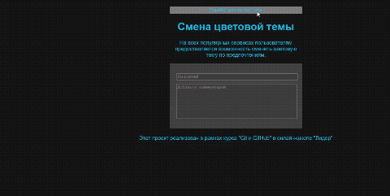

# Проект: Смена цветовой темы

Учебный проект, реализованный в рамках курса "Git и GitHub" в онлайн-школе "Лидер".

## Описание
Простой веб-сайт с формой обратной связи, который позволяет пользователю переключаться между светлой и темной цветовыми темами. Тема переключается по клику на кнопку, при этом меняется текст кнопки и цветовая схема страницы.

## Технологии
* HTML5
* CSS3 (переменные, `color-scheme`)
* JavaScript (DOM, обработка событий)

## Как запустить
Просто откройте файл `index.html` в любом современном браузере.

## Пример работы   

